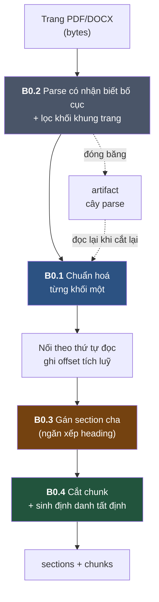
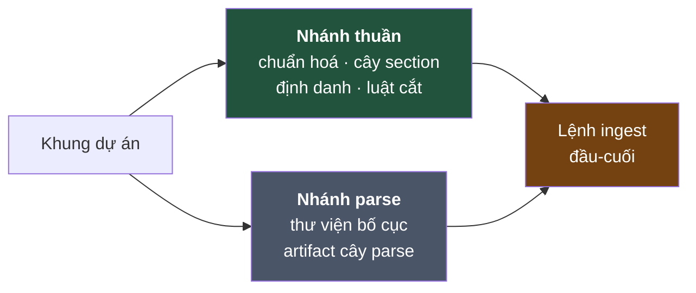

# Phân tích luồng B0 — truy vết một đoạn văn từ trang PDF tới chunk

> Tài liệu để **đọc hiểu**, không phải để triển khai. Spec triển khai là [`B0-chunking-spec.md`](./B0-chunking-spec.md).
>
> Mọi con số, offset và mã băm trong tài liệu này đều được **tính thật** bằng script chứ không phải minh hoạ.
> Bạn chạy lại đúng công thức sẽ ra đúng những giá trị đó.

---

## 1. Bản đồ luồng, và một nghịch lý ngay ở tên gọi



**Nghịch lý:** B0.**2** chạy trước B0.**1**.

Sơ đồ trong `B0-ingestion-spec.md` §1 vẽ ngược lại — chuẩn hoá trước, parse sau. Nhưng một file PDF **chưa
parse thì chưa có văn bản nào để chuẩn hoá**; nó mới chỉ là bytes. Thứ tự thật buộc phải là parse trước.

Tên bước giữ nguyên theo spec gốc để khỏi loạn tham chiếu, nhưng **thứ tự thực thi là 2 → 1 → 3 → 4**.

---

## 2. Chặng 0 — Trang giấy đầu vào

Giả sử trang 47 của một giáo trình:

```
              Chương 2: Mô hình ngôn ngữ

    Chương này trình bày các kiến trúc nền tảng của mô hình ngôn
    ngữ hiện đại, từ Trans-
    former tới các biến thể gần đây.

    2.1  Kiến trúc Transformer

    Transformer bỏ hồi quy và thay bằng cơ chế tự chú ý,  cho phép
    huấn luyện song song.

                        — 47 —
```

Bốn thứ trong trang này sẽ gây chuyện, và cả bốn đều là ca thật hay gặp ở PDF tiếng Việt:

| Chi tiết | Vấn đề |
|---|---|
| Chữ **`ngữ`** | PDF trả về ở dạng **tổ hợp dấu**, không phải dạng dựng sẵn |
| **`Trans-`** cuối dòng | Từ bị ngắt ngang bởi dấu gạch nối |
| **`ý,  cho`** | Hai dấu cách liền nhau do dàn chữ |
| **`— 47 —`** | Số trang, không phải nội dung |

---

## 3. Chặng 1 — B0.2 Parse

Thư viện parse trả về các khối kèm **thứ tự đọc toàn cục**:

| # | Loại | Cấp | Nội dung thô |
|---|---|---|---|
| n0 | `section_header` | 1 | `Chương 2: Mô hình ngôn ngữ` |
| n1 | `paragraph` | — | `Chương này trình bày … ngôn\nngữ hiện đại, từ Trans-\nformer tới …` |
| n2 | `section_header` | 2 | `2.1  Kiến trúc Transformer` |
| n3 | `paragraph` | — | `Transformer bỏ hồi quy … ý,  cho phép\nhuấn luyện song song.` |
| ~~nX~~ | ~~`page_footer`~~ | — | ~~`— 47 —`~~ ← **bị lọc ngay tại đây** |

**Số trang biến mất ở chặng này, không phải ở chặng chuẩn hoá.** Spec gốc xếp việc "bỏ header/footer/số trang
lặp" vào B0.1 như một phép biến đổi chuỗi. Nhưng khi đã parse xong thì số trang là **một khối riêng đã được
phân loại**, xoá nó chỉ là bỏ một phần tử khỏi danh sách. Đi tìm nó bằng biểu thức chính quy trên chuỗi đã nối
là tự làm khó mình — và rủi ro xoá nhầm một dòng nội dung trông giống số trang.

---

## 4. Chặng 2 — B0.1 Chuẩn hoá, **từng khối một**

### Ví dụ trung tâm: chữ `ngữ`

Đây là ví dụ đáng nhớ nhất của cả pha, vì nó cho thấy vì sao chuẩn hoá Unicode là **bắt buộc** chứ không phải
làm cho đẹp:

```
PDF trả về :  U+006E  U+0067  U+01B0  U+0303        → 4 codepoint
                n       g       ư      ◌̃ (dấu ngã rời)

Sau NFC    :  U+006E  U+0067  U+1EEF                → 3 codepoint
                n       g       ữ
```

Hai chuỗi này **hiển thị y hệt nhau trên màn hình**, nhưng với máy tính chúng **khác nhau**:

```python
"ngữ" (tổ hợp) == "ngữ" (dựng sẵn)   →  False
NFC(tổ hợp)    == "ngữ" (dựng sẵn)   →  True
```

Hậu quả nếu bỏ qua: bước mention map dùng khớp chuỗi chính xác để tìm nơi một khái niệm được nhắc tới. Node
tên `"Mô hình ngôn ngữ"` sẽ **không khớp** đoạn văn viết `"mô hình ngôn ngữ"` chỉ vì một bên dựng sẵn một bên
tổ hợp. Khái niệm biến mất khỏi bản đồ, không có lỗi nào được báo, và bạn chỉ phát hiện khi đồ thị đã dựng xong
và thiếu cạnh.

**Và nó làm đổi độ dài chuỗi** — 4 codepoint thành 3. Đây chính là lý do vị trí ký tự **bắt buộc** phải tính
trên văn bản đã chuẩn hoá.

### Kết quả chuẩn hoá cả bốn khối

| # | Thô | Sau chuẩn hoá | Đổi | Vì sao |
|---|---|---|---|---|
| n0 | 27 | **26** | −1 | `ngữ` gộp dấu |
| n1 | 118 | **115** | −3 | `ngữ` gộp dấu (−1), `Trans-\nformer` nối lại (−2) |
| n2 | 26 | **25** | −1 | hai dấu cách thành một |
| n3 | 84 | **83** | −1 | hai dấu cách thành một |

Nội dung sau chuẩn hoá:

```
n0: "Chương 2: Mô hình ngôn ngữ"
n1: "Chương này trình bày các kiến trúc nền tảng của mô hình ngôn ngữ hiện đại,
     từ Transformer tới các biến thể gần đây."
n2: "2.1 Kiến trúc Transformer"
n3: "Transformer bỏ hồi quy và thay bằng cơ chế tự chú ý, cho phép huấn luyện song song."
```

`Trans-` và `former` đã thành `Transformer`. Nếu bỏ bước này, bước mention map sẽ đi tìm `"Transformer"` và
không bao giờ tìm thấy nó ở đây.

> **Vì sao chuẩn hoá từng khối rồi mới nối, chứ không nối rồi chuẩn hoá?**
> Vì chuẩn hoá **làm đổi độ dài**. Nếu nối trước rồi chuẩn hoá cả chuỗi, bạn mất dấu ranh giới giữa các khối —
> muốn biết khối nào nằm ở đâu phải dựng thêm một bảng đối chiếu vị trí trước/sau. Chuẩn hoá từng khối rồi
> nối thì offset **tự nhiên là đúng**, không cần bảng nào.

---

## 5. Chặng 3 — Nối và ghi offset

`n0` và `n2` là heading: nội dung đã chuẩn hoá của chúng được lưu trong cây section, nhưng không nằm trong
không gian tọa độ của chunk. Chỉ hai leaf block `n1`, `n3` được nối bằng `\n` và ghi vị trí:

```
n1: [  0, 115)   "Chương này trình bày…"
                 ── \n ──
n3: [116, 199)   "Transformer bỏ hồi quy…"

normalized_full_text = 199 codepoint
```

Bất biến **I9** áp dụng cho leaf block — cắt chuỗi đầy đủ theo vị trí phải ra đúng nội dung chunk:

```
full[  0:115] == n1.text   →  True
full[116:199] == n3.text   →  True
```

Đúng cả hai, **không cần bảng ánh xạ offset**. Đó là phần thưởng của việc chuẩn hoá từng khối trước khi nối:
bất biến I9 đúng do cách xây dựng. Khoảng `[115,116)` là dấu phân cách nên hai span rời nhau và không liền kề.

---

## 6. Chặng 4 — B0.3 Gán section cha

Đây là phần spec tự nhận là **dễ sai nhất**. Luật một câu:

> Section cha của một khối = **heading đang mở gần nhất** bao quanh nó.

### Truy vết ngăn xếp, từng bước

Ngăn xếp bắt đầu với một phần tử canh đáy là section gốc:

| Bước | Gặp | Thao tác | Ngăn xếp sau đó | Kết quả |
|---|---|---|---|---|
| 0 | — | khởi tạo | `[gốc]` | |
| 1 | n0 heading cấp 1 | lấy ra mọi heading cấp ≥ 1 → không có; đẩy vào | `[gốc, s_ch2]` | tạo `s_ch2` |
| 2 | n1 đoạn văn | đọc đỉnh | `[gốc, s_ch2]` | chunk → cha là **`s_ch2`** |
| 3 | n2 heading cấp 2 | lấy ra mọi heading cấp ≥ 2 → không có; đẩy vào | `[gốc, s_ch2, s_21]` | tạo `s_21` |
| 4 | n3 đoạn văn | đọc đỉnh | `[gốc, s_ch2, s_21]` | chunk → cha là **`s_21`** |

### Hệ quả quan trọng nhất

**Nội dung trực tiếp của một section là các khối từ ngay sau heading của nó tới ngay trước heading con đầu
tiên — KHÔNG phải toàn bộ subtree.**

Lấy ví dụ đầy đủ hơn từ §4.5 của spec gốc:

```
Chương 2: Mô hình ngôn ngữ            s_2    (cấp 1)
   ¶ "Chương này trình bày…"          c_0001   cha = s_2
   ¶ "Ta bắt đầu từ kiến trúc…"       c_0002   cha = s_2
   2.1 Kiến trúc Transformer          s_21   (cấp 2)
      ¶ "Transformer bỏ hồi quy…"     c_0003   cha = s_21
      ¶ "Gồm encoder và decoder…"     c_0004   cha = s_21
      2.1.1 Cơ chế Attention          s_211  (cấp 3)
         ¶ "Attention gán trọng số…"  c_0005   cha = s_211
         ¶ "Với scaled dot-product…"  c_0006   cha = s_211
         formula                      c_0007   cha = s_211
         table "Ký hiệu Q,K,V,dₖ"     c_0008   cha = s_211
      2.1.2 Multi-head Attention      s_212  (cấp 3)
         ¶ "Multi-head chạy h phép…"  c_0009   cha = s_212
```

Bốn window được sinh ra:

| Window | Chứa | Ghi chú |
|---|---|---|
| `s_2` | `c_0001`, `c_0002` | **chỉ** hai đoạn preamble chương |
| `s_21` | `c_0003`, `c_0004` | **chỉ** hai đoạn preamble mục |
| `s_211` | `c_0005`, `c_0006`, `c_0007`, `c_0008` | |
| `s_212` | `c_0009` | |

**Window `s_2` không chứa `c_0003`, cũng không chứa `c_0005`.** Đây là điểm nhiều người đọc lướt sẽ hiểu sai —
"window của chương 2" nghe như phải gồm cả chương.

### Lỗi kinh điển, và vì sao nó khó phát hiện

Nếu viết nhầm — đẩy heading vào ngăn xếp **trước khi** lấy ra, hoặc đọc `ngăn_xếp[0]` thay vì đỉnh — kết quả
thành:

| | Đúng | Sai |
|---|---|---|
| Số chunk | 9 | **9** |
| Tổng kích thước các window | 9 | **9** |
| Các window rời nhau | ✅ | **✅** |
| Số window | 4 | **1** |
| `c_0005` thuộc window | `s_211` | `s_root` |

Ba dòng đầu **vẫn đúng**. Bất biến I1 vẫn xanh. Không có lỗi nào được ném ra. Cả chín chunk gom vào một window
khổng lồ, và bước trích khái niệm sẽ đọc cả chương trong một lời gọi rồi trả về một mớ khái niệm trộn lẫn —
thứ chỉ lộ ra rất muộn, khi đồ thị đã dựng và không ai truy được về đâu.

Đó là toàn bộ lý do tồn tại của lệnh `inspect`: **nhìn cây một giây là thấy, nhìn số liệu thì không.**

---

## 7. Chặng 5 — B0.4 Cắt chunk và sinh định danh

### Luật cắt

| Tình huống | Xử lý |
|---|---|
| `text` / `paragraph` / `list_item` liền nhau | gộp trong cùng section tới đích 256 token, không vượt trần 512 |
| Khối **dài** hơn ngưỡng | cắt theo ranh giới câu, chồng lấn 1 câu, đánh chỉ số mảnh |
| Nhóm cuối section ngắn hơn đích | giữ nguyên vì không còn block hợp lệ để gộp |
| Hình / cước chú | đứng riêng; caption hình là nội dung và không lặp ở tiền tố |
| Bảng | đứng riêng; bảng dài cắt theo hàng và lặp dòng tiêu đề cột |

Vị trí của chunk gộp chạy từ đầu block đầu tới cuối block cuối và bao gồm đúng các ký tự `\n` giữa chúng, nên
I9 vẫn giữ: `normalized_full_text[char_start:char_end] == chunk.text`. Không gộp qua section để I16 giữ và để
mỗi chunk vẫn thuộc đúng một window.

### Định danh

```
section_id = "s_" + blake2b(doc_id | section_path | section_occurrence)
chunk_id   = "c_" + blake2b(doc_id | parent_section_id | normalized_text | split_index | chunk_occurrence)
```

`section_occurrence` tách các section trùng đường dẫn. `chunk_occurrence` chỉ đếm trong một
`parent_section_id`, nên hai section anh em trùng tên không chia sẻ bộ đếm chunk.

> **Chi tiết triển khai:** `_stable_id` tuần tự hoá danh sách các thành phần bằng JSON compact UTF-8 rồi băm
> BLAKE2b với digest 12 byte. Cấu trúc JSON phân biệt an toàn `section_path = ["So sánh A", "B"]` với
> `section_path = ["So sánh A > B"]`; không cần tự chọn một ký tự phân cách đặc biệt.

---

## 8. Bằng chứng: vì sao công thức gốc phải bị thay

Đây là phần đáng đọc nhất của tài liệu này.

**Kịch bản:** tác giả thêm một đoạn *Lời nói đầu* vào **đầu** tài liệu. Không có chữ nào trong chương 2 bị sửa.

Mọi thứ phía sau dịch đi:

```
span của đoạn preamble chương:  [0, 115)  →  [69, 184)     dịch 69 ký tự
order_index của nó           :        1    →        2
```

Giờ so hai công thức. Digest cụ thể được kiểm bằng test; ở đây dùng ký hiệu để tránh tài liệu bị lệch khi cách
tuần tự hoá hoặc công thức được nâng version.

### Công thức mới — nội dung + `parent_section_id`

```
preamble chương : id_before  →  id_before   ✅ GIỮ NGUYÊN
đoạn trong 2.1  : id_before  →  id_before   ✅ GIỮ NGUYÊN
```

### Công thức gốc §5.2 — có `order_index` và vị trí ký tự

```
preamble chương : id_before  →  id_after   ❌ ĐỔI
đoạn trong 2.1  : id_before  →  id_after   ❌ ĐỔI
```

Đoạn văn **không hề bị sửa một chữ nào**, nhưng định danh của nó đổi hoàn toàn — vì `order_index` dịch từ 1
sang 2 và span dịch 69 ký tự, mà cả hai đều nằm trong khoá băm.

Trong khi đó §9 của chính spec gốc hứa:

> *"nhờ `chunk_id` tất định, re-chunk giữ nguyên id cho block không đổi ⇒ evidence của các bước Pha A trước
> đó không gãy"*

Lời hứa đó **không giữ được** bằng công thức ở §5.2. Và bộ test I5 đi kèm **không phát hiện ra**, vì nó chỉ
kiểm *"ingest 2 lần cùng file ⇒ tập chunk_id giống hệt"* — điều kiện mà công thức sai vẫn thoả hoàn hảo.

Đó là lý do spec mới thêm bài **I11**: chèn một đoạn vào đầu rồi đòi section và chunk không đổi phải giữ
nguyên định danh. Một test riêng dùng hai section anh em trùng tên để bảo đảm sửa section thứ nhất không làm
đổi `chunk_id` trong section thứ hai.

### Cái giá phải trả

Công thức mới không hoàn hảo. Vì `section_path` quyết định `section_id`, rồi `section_id` nằm trong khoá băm
của chunk, **đổi tên một tiêu đề sẽ làm đổi định danh mọi chunk nằm dưới nó**:

```
"Chương 2: Mô hình ngôn ngữ"  →  "Chương 2: Mô hình ngôn ngữ lớn"
   ⇒ mọi chunk trong chương 2 đổi định danh
```

Không có phương án nào tránh được hoàn toàn — đó là cái giá của việc dùng đường dẫn để phân biệt hai đoạn văn
trùng nội dung nằm ở hai chương khác nhau. Đánh đổi này được chấp nhận vì **sửa tiêu đề hiếm hơn nhiều so với
sửa nội dung**. Ghi rõ trong [ADR 0001](./adr/0001-dinh-danh-tat-dinh.md).

---

## 9. Hai nhánh chạy song song



| | Nhánh thuần | Nhánh parse |
|---|---|---|
| Đầu vào | cây dựng bằng tay | bytes thật |
| Tất định | **tuyệt đối** | chỉ ổn định khi ghim phiên bản |
| Tốc độ test | mili-giây | giây tới phút |
| Phủ bất biến | I1–I16 | không |

Tách đôi vì thư viện parse dùng mô hình học máy. Nếu để nó nằm trong đường chạy của I1–I16 thì bộ test vừa
chậm vừa có thể đổi kết quả khi nâng phiên bản — đúng thứ làm một bộ test bảo vệ bất biến **mất hết giá trị**.

**Artifact cây parse là bản lề.** Parse chạy một lần rồi đóng băng; mọi lần cắt lại chunk đọc từ đó. Nhờ vậy
thử nghiệm tham số cắt không phải chờ mô hình bố cục chạy lại, và bước cắt trở nên tất định trên thực tế dù
thư viện parse thì không.

### Đối chiếu `section-id-v3` trên giáo trình thật — 2026-08-15

| Số đo | Kết quả |
|---|---:|
| Docling item → node giữ lại | 170 → 158 |
| Section / window | 27 / 22 |
| Chunk tổng / chunk text gộp | 50 / 39 |
| Trung vị token toàn bộ / riêng text gộp | 202 / 248 |
| Chunk lớn nhất / vượt trần | 400 / 0 |
| Thời gian parse lần đầu / ingest lại từ cache | 146,6 giây / 0,74 giây |

Cây số có cấp 1→2→3; các mục `a)` tạo cấp 4 đúng luật. `CHƯƠNG 1` có bốn section con trực tiếp.
`trong đó:` không còn là section; không chunk nào còn placeholder HTML hay glyph Latin lặp; toàn bộ char span
khớp. Con số dự báo 39 chunk là số **chunk text gộp**; tổng là 50 vì tám hình và ba cước chú bắt buộc đứng
riêng. Do đó trung vị text đạt gần đích 256, còn trung vị toàn bộ là 202.

---

## 10. Hợp đồng xuôi dòng — ai dùng gì của B0

Đây là câu trả lời cho "vì sao B0 phải thiết kế đúng như vậy". Mỗi ràng buộc tồn tại vì có một bên tiêu thụ
cụ thể cần nó.

| Bên tiêu thụ | Lấy gì từ B0 | Nếu B0 sai thì hỏng thế nào |
|---|---|---|
| **T1 — trích khái niệm** | window gom theo section cha | Window phình thành cả chương ⇒ một lời gọi trả về mớ khái niệm trộn lẫn, không tách được |
| **M — mention map** | `chunk_id` làm **cột** của ma trận khái niệm × chunk | Định danh đổi qua mỗi lần ingest ⇒ ma trận xáo cột, provenance trỏ vào hư không |
| **T2b — suy luận quan hệ** | `order_index`, `section_path`, cấp heading | Thứ tự đọc sai ⇒ suy nhầm khái niệm nào dạy trước, cạnh trong đồ thị đảo chiều |
| **RAG trực tuyến** | chunk nhỏ để khớp + section cha để ráp ngữ cảnh | Chunk quá to ⇒ khớp không chính xác; không có section cha ⇒ không ráp được ngữ cảnh |

### Bốn ràng buộc và chủ sở hữu của chúng

| Ràng buộc của B0 | Tồn tại vì |
|---|---|
| Chuẩn hoá Unicode NFC | **M** dùng khớp chuỗi chính xác |
| Định danh ổn định qua các lần ingest | **M** dùng nó làm cột ma trận; mọi bước dùng nó làm bằng chứng |
| Window phân hoạch phủ hết và rời nhau | **T1** — không khái niệm nào bị trích hai lần, không đoạn nào rơi |
| Thứ tự đọc toàn cục chính xác tới từng khối | **T2b** — vị trí xuất hiện đầu tiên không được làm tròn về đầu mục |

### Một điều phản trực giác: phân mảnh quá mức là **cố ý**

Một khái niệm giới thiệu ở preamble chương rồi khai triển ở mục con sẽ sinh ra **hai ứng viên rời nhau** ở hai
window khác nhau. Trông như lỗi.

Nó không phải lỗi. Bước hợp nhất phía sau (T2a) được sinh ra để gộp chúng lại — gom theo độ giống ngữ nghĩa
rồi cho agent kiểm định từng cụm. Còn nếu cố gom window to hơn để "tránh phân mảnh", bạn sẽ dồn nhiều khái
niệm vào **một** ứng viên, và **không có bước nào phía sau tách chúng ra được nữa**.

Sai loại một (gộp nhầm) sửa được. Sai loại hai (bỏ sót) thì không. Toàn bộ Pha A được thiết kế nghiêng về phía
sai loại một.

---

## 11. Bảng tra nhanh những chỗ dễ sai

| Chỗ | Triệu chứng | Vì sao khó thấy |
|---|---|---|
| Đẩy heading trước khi lấy ra | Mọi chunk trỏ về section gốc | Số chunk vẫn đúng, I1 vẫn xanh, không lỗi nào được ném |
| Đọc `ngăn_xếp[0]` thay vì đỉnh | Như trên | Như trên |
| Nối trước rồi chuẩn hoá | Vị trí ký tự lệch | Chỉ lộ khi đi trích dẫn ngược, lúc đó đã muộn |
| Bỏ chuẩn hoá NFC | Mention map trượt khái niệm | Hai chuỗi hiển thị **y hệt** trên màn hình |
| `doc_id` lấy từ hash nội dung file | Sửa một dấu phẩy là đổi hết định danh | Test "chạy 2 lần cùng file" vẫn xanh |
| Băm định danh kèm vị trí | Chèn đoạn ở đầu là đổi hết phía sau | Test I5 của spec gốc **không** bắt được |
| Gộp qua ranh giới section | Một chunk thuộc hai window ngữ nghĩa | I16 chặn trực tiếp |
| Tự nối `section_path` bằng một dấu phân cách khi băm | Đụng độ nếu dấu đó xuất hiện trong tiêu đề | Cực hiếm, và khi xảy ra thì không ai đoán ra nguyên nhân; tuần tự hoá JSON tránh hẳn lỗi này |

---

## Tham chiếu

- [`B0-chunking-spec.md`](./B0-chunking-spec.md) — spec triển khai
- [`adr/0001-dinh-danh-tat-dinh.md`](./adr/0001-dinh-danh-tat-dinh.md) — quyết định định danh
- [`B0-ingestion-spec.md`](./B0-ingestion-spec.md) — spec gốc (còn hiệu lực trừ ba điểm đã vá)
- [`spec-preview.md`](./spec-preview.md) — toàn cảnh Pha A
- [`../CONTEXT.md`](../CONTEXT.md) — từ điển thuật ngữ
- [`../task/b0-chunking/`](../task/b0-chunking/) — các ticket
