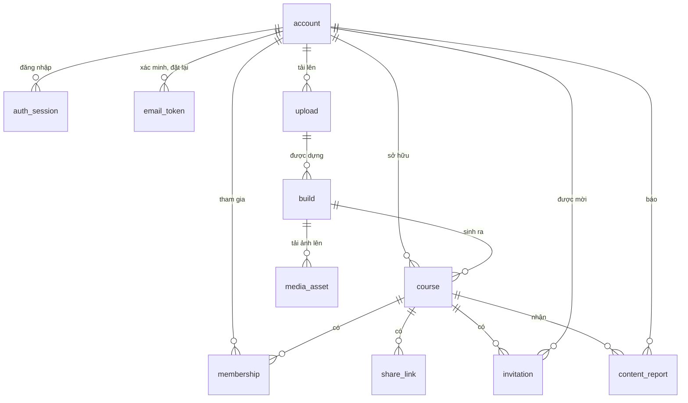

# Spec cơ sở dữ liệu web — PostgreSQL cho dữ liệu web và kho Pha B

**Ngày:** 2026-10-18. **Nhãn:** `ready-for-agent`. **Trạng thái:** chờ chia vé; vé ở `task/web/`.

**Dựa trên:** [spec chức năng web](web-chuc-nang-spec.md), mục 13 (mức khái niệm). Spec này cụ thể hoá thành bảng, khoá, chỉ mục, ràng buộc, giao dịch, di
trú và sao lưu.

**Quyết định kiến trúc đi kèm:** [ADR 0022](adr/0022-postgresql-cho-du-lieu-web-artifact-o-kho-tep-hang-doi-bang-bang.md): PostgreSQL cho dữ liệu web và
kho Pha B; artifact Pha A giữ ở kho tệp; hàng đợi bản dựng là một bảng. [ADR 0023](adr/0023-cloudinary-cho-tep-goc-va-anh.md): tệp gốc và ảnh ở
Cloudinary, riêng tư.

---

## Vấn đề

- Kho Pha B hiện là một tệp JSON, ghi lại cả tệp sau mỗi thay đổi, và chỉ an toàn trong một tiến trình.
- `single_flight` và bản ghi hỏng 60 giây (`negative_ttl_seconds`) sống trong bộ nhớ của một tiến trình. Hai worker web không thấy nhau, nên sinh trùng bài
  và gọi lại ngay sau một lỗi mạng.
- **Trần ngày của người học** (Pha B2 mục 8) cần tổng chi hôm nay của một người trên mọi cuốn. Port hiện chỉ có `usage_rows(doc_id)`, nên phải đọc **cả**
  sổ chi rồi lọc. Trên một sổ chi lớn dần, mỗi tin nhắn sẽ chậm dần.
- Dữ liệu web (tài khoản, khoá học, chia sẻ, bản dựng) chưa có chỗ lưu.

## Giải pháp

- **Một cơ sở dữ liệu PostgreSQL 16** chứa cả dữ liệu web lẫn kho Pha B.
- **Kho Pha B trên PostgreSQL** là bản cài thứ ba của port `PhaseBStore`, qua cùng bộ test hợp đồng với bản JSON và bản bộ nhớ.
- **Port Pha B nới hai chỗ**, giữ tương thích ngược:
  - `usage_rows` có thêm bộ lọc theo người, thời điểm và mục đích;
  - thêm hàm ẩn danh hoá sổ chi của một người khi xoá tài khoản.
- **Artifact Pha A** (đồ thị, chunk, vector) vẫn ở **kho tệp trên đĩa**. **Tệp tải lên và ảnh** ở **Cloudinary** (ADR 0023). Cơ sở dữ liệu chỉ giữ tham chiếu.
- **Di trú bằng Alembic,** mỗi vé một bản di trú. Cơ sở dữ liệu luôn dựng được từ rỗng.

---

## Quyết định triển khai

### 1. Công cụ và quy ước

- **PostgreSQL 16** chạy bằng Docker (`src/web/docker-compose.yml`: `db` cổng 5432 với volume có tên; `db-test` cổng 5433 với `tmpfs`), driver psycopg 3,
  SQLAlchemy 2, di trú Alembic ở `src/web/backend/wayfinder/migrations/`.
- **Mã lưu trữ ở `wayfinder`,** kể cả `PostgresPhaseBStore`. Lõi `doc2roadmap` không phụ thuộc SQLAlchemy hay psycopg.
  - Domain và application không thấy model SQLAlchemy. Bản cài port chuyển hàng thành thực thể domain hay `dict` như port quy định.
- **Tên:** `snake_case`; tên bảng số ít (`account`, `course`).
- **Khoá chính:** `uuid` do ứng dụng sinh (UUID v4) cho thực thể web; `bigint` tự tăng cho bảng chỉ ghi thêm (`usage_ledger`, `audit_event`).
- **Thời gian:** mọi cột là `timestamptz`, lưu UTC. "Ngày" và "tháng" của trần chi đổi sang `Asia/Ho_Chi_Minh` lúc truy vấn.
- **Tiền:** `numeric(12, 6)`, đơn vị USD.
- **Giá trị liệt kê:** cột `text` kèm `CHECK (… IN (…))`, không dùng kiểu `ENUM` của PostgreSQL, để thêm giá trị chỉ cần một di trú nhỏ.
- **JSON:** `jsonb`, chỉ cho payload của Pha B và siêu dữ liệu nhật ký. Dữ liệu web có cột riêng.
- **Bí mật:** token phiên, token email, token link mời, token lời mời chỉ lưu **băm SHA-256** (`bytea`, 32 byte). Mật khẩu lưu chuỗi Argon2id.
- **Xoá:** xoá cứng. Không có cột `deleted_at`, trừ khi spec ghi rõ.

### 2. Sơ đồ quan hệ



Bảng Pha B (`phase_b_cache`, `phase_b_negative`, `phase_b_record`, `usage_ledger`) **không** có khoá ngoại sang bảng web: chúng khoá theo `owner` (chuỗi
`user_id`) và `doc_id` như port hiện tại. Xoá tài khoản dọn chúng bằng thủ tục ở mục 6.

### 3. Bảng web

**`account`**

| cột | kiểu | ràng buộc |
|---|---|---|
| `id` | uuid | khoá chính |
| `email` | text | not null; email người dùng gõ, đã cắt khoảng trắng |
| `email_normalized` | text | not null; `lower(email)`; **unique** |
| `password_hash` | text | not null; chuỗi Argon2id |
| `display_name` | text | not null; 1–60 ký tự (`CHECK`) |
| `role` | text | `user` \| `admin`; mặc định `user` |
| `status` | text | `active` \| `disabled`; mặc định `active` |
| `email_verified_at` | timestamptz | null khi chưa xác minh |
| `build_monthly_max` | integer | null thì dùng `WebSettings.build_monthly_max` |
| `created_at`, `updated_at`, `last_login_at` | timestamptz | |

**`auth_session`**

| cột | kiểu | ràng buộc |
|---|---|---|
| `id` | uuid | khoá chính |
| `account_id` | uuid | FK `account` **on delete cascade**; chỉ mục |
| `token_hash` | bytea | unique |
| `csrf_token` | text | not null; 32 byte ngẫu nhiên dạng base64url |
| `created_at`, `last_seen_at` | timestamptz | |
| `expires_at` | timestamptz | hạn tuyệt đối (30 ngày); chỉ mục |
| `ip` | inet | |
| `user_agent` | text | cắt ở 200 ký tự |

- Phiên hợp lệ khi `expires_at > now()` và `last_seen_at > now() - session_idle_days`.
- `last_seen_at` chỉ ghi lại khi cũ hơn 5 phút, để mỗi yêu cầu không phải là một lần ghi.

**`email_token`**

| cột | kiểu | ràng buộc |
|---|---|---|
| `id` | uuid | khoá chính |
| `account_id` | uuid | FK `account` on delete cascade |
| `purpose` | text | `verify_email` \| `reset_password` |
| `token_hash` | bytea | unique |
| `email_normalized` | text | email lúc gửi; xác minh chỉ có hiệu lực nếu còn trùng email hiện tại |
| `expires_at`, `used_at`, `created_at` | timestamptz | `used_at` null khi chưa dùng |

**`rate_limit_event`** (giới hạn tần suất, dùng chung mọi worker)

| cột | kiểu | ràng buộc |
|---|---|---|
| `bucket` | text | ví dụ `login:email:<sha256 email>`, `login:ip:<ip>`, `assistant:<user_id>`, `reset:<sha256 email>` |
| `at` | timestamptz | |

- Chỉ mục `(bucket, at)`. Đếm sự kiện trong cửa sổ bằng một truy vấn; dọn hàng cũ hơn 1 ngày bằng việc định kỳ.
- `bucket` theo email dùng băm của email, để bảng này không chứa email.

**`upload`**

| cột | kiểu | ràng buộc |
|---|---|---|
| `id` | uuid | khoá chính |
| `account_id` | uuid | FK `account` **on delete set null** |
| `sha256` | bytea | not null; chỉ mục (không unique: hai người tải cùng tệp) |
| `original_name` | text | ≤ 255 ký tự; chỉ là siêu dữ liệu |
| `kind` | text | `pdf` \| `docx` |
| `size_bytes` | bigint | |
| `page_count` | integer | null với DOCX |
| `public_id` | text | unique; `public_id` ngẫu nhiên trên Cloudinary, trong `wayfinder/<env>/uploads/` |
| `resource_type` | text | `image` (PDF, để cắt trang) \| `raw` (DOCX) |
| `rights_confirmed_at` | timestamptz | not null |
| `created_at` | timestamptz | |

**`build`**

| cột | kiểu | ràng buộc |
|---|---|---|
| `id` | uuid | khoá chính |
| `doc_id` | text | not null; `u-` + 20 hex đầu của `sha256`; chỉ mục |
| `upload_id` | uuid | FK `upload` |
| `requested_by` | uuid | FK `account` on delete set null |
| `status` | text | `reading` \| `rejected` \| `awaiting_confirmation` \| `queued` \| `running` \| `succeeded` \| `failed` \| `cancelled` |
| `step` | text | `doc_reading` \| `concepts` \| `graph` \| `learning_prep` \| null |
| `spent_usd` | numeric(12,6) | chi thực quy đổi từ token, mặc định 0; không có trường dự toán theo quyết định 2026-10-19 |
| `model_calls`, `input_tokens`, `output_tokens` | integer | số thực của lượt chạy từ `BuildResult` |
| `usage_complete` | boolean | cờ phân biệt kết quả thiếu số usage, không suy chi thực là 0 khi thiếu |
| `elapsed_seconds` | double precision | thời gian thực chạy, không dự toán |
| `pipeline_version` | text | not null; commit và phiên bản cấu hình của chuỗi |
| `counts_quota` | boolean | true khi người dùng xác nhận một bản dựng có chi |
| `cancel_requested` | boolean | mặc định false |
| `claim_count` | integer | số lần worker nhận việc; tối đa 2 |
| `claimed_by` | text | tên worker |
| `heartbeat_at` | timestamptz | |
| `error_code`, `error_message` | text | |
| `retryable` | boolean | |
| `confirmation_expires_at`, `queued_at`, `started_at`, `finished_at`, `created_at` | timestamptz | |

- **Chỉ mục hàng đợi:** `(queued_at) WHERE status = 'queued'`.
- Worker W-14 nối callback `BuildResult` của W-13 để ghi usage/kết quả khi thành công/lỗi/huỷ; SQLite CLI không thay PostgreSQL web. Các số này dành cho
  admin/đối soát, không trả chi phí/dự toán trong API cho người dùng. Không cộng lại chi lịch sử từ artifact/cache.
- **Chỉ mục dùng lại:** `(doc_id, pipeline_version) WHERE status = 'succeeded'`.
- **Ràng buộc chạy dở:** unique `(doc_id, pipeline_version) WHERE status IN ('reading','awaiting_confirmation','queued','running')`. Hai lần tải cùng tệp
  cùng lúc không tạo hai bản dựng chạy song song; lần sau gắn vào bản dựng đang có.
- **Lượt dựng tháng này** của một người: đếm `build` có `requested_by = id`, `counts_quota = true`, `queued_at` trong tháng lịch theo giờ Việt Nam.

**`course`**

| cột | kiểu | ràng buộc |
|---|---|---|
| `id` | uuid | khoá chính |
| `owner_id` | uuid | FK `account` **on delete restrict**; chỉ mục |
| `doc_id` | text | not null; chỉ mục |
| `build_id` | uuid | FK `build`, null với khoá mẫu |
| `title` | text | 1–120 ký tự |
| `description` | text | ≤ 1.000 ký tự |
| `status` | text | `building` \| `ready` \| `failed` |
| `published_graph_version` | integer | null khi chưa `ready` |
| `module_count` | integer | metadata số module của graph đã ghim, ≥ 0; backend tính khi tạo/phát hành, không nhận từ người dùng |
| `source_public_id` | text | nullable; định danh PDF mẫu ở MediaStore, chỉ phía server; nguồn upload/build được nối ở W-14 |
| `is_sample` | boolean | mặc định false; chỉ mục `WHERE is_sample` |
| `created_at`, `updated_at` | timestamptz | |

`on delete restrict` ở `owner_id` là chốt chặn cuối cho luật "xoá tài khoản khi còn khoá có thành viên khác thì từ chối". Thủ tục xoá tài khoản (mục 6) xoá
khoá học của người đó trước.

**Lát schema W-06 → W-14:** `w06_0005` tạo `build_id` UUID nullable khi bảng `build` chưa tồn tại; API W-06 không cho client gán trường này.
W-14 phải thêm FK `course.build_id → build.id` trong migration tạo bảng build, đối chiếu nguồn upload/PDF và bổ sung test FK;
không sửa migration W-06 đã ghép. `source_public_id` phục vụ PDF mẫu không có build/upload; không trả public_id/URL Cloudinary lâu dài qua API card.
`module_count` phải cập nhật cùng `published_graph_version` khi chức năng phát hành bản mới được triển khai.

**`membership`**

| cột | kiểu | ràng buộc |
|---|---|---|
| `course_id` | uuid | FK `course` on delete cascade |
| `account_id` | uuid | FK `account` on delete cascade; chỉ mục |
| `role` | text | `owner` \| `learner` |
| `via` | text | `owner` \| `link` \| `email` \| `sample` |
| `joined_at`, `last_active_at` | timestamptz | |

- Khoá chính `(course_id, account_id)`.
- **Đúng một chủ mỗi khoá:** unique `(course_id) WHERE role = 'owner'`. Tạo khoá học và hàng `membership` chủ khoá trong cùng một giao dịch.
- `last_active_at` ghi lại khi cũ hơn 5 phút, như `auth_session.last_seen_at`.
- Đếm thành viên để kiểm `course_max_members` trong cùng giao dịch với lần chèn, sau khi khoá hàng `course` (`SELECT … FOR UPDATE`), để hai người tham gia
  cùng lúc không vượt trần.

**`share_link`**

| cột | kiểu | ràng buộc |
|---|---|---|
| `id` | uuid | khoá chính |
| `course_id` | uuid | FK `course` on delete cascade; chỉ mục |
| `token_hash` | bytea | unique |
| `token_tail` | text | 6 ký tự cuối, để hiện trong danh sách |
| `created_by` | uuid | FK `account` on delete set null |
| `expires_at` | timestamptz | null là không hết hạn |
| `max_uses` | integer | null là không giới hạn |
| `use_count` | integer | mặc định 0 |
| `revoked_at`, `created_at` | timestamptz | |

`use_count` tăng trong cùng giao dịch với hàng `membership` mới, bằng `UPDATE … WHERE use_count < max_uses`, để không vượt `max_uses` khi nhiều người bấm
cùng lúc.

**`invitation`**

| cột | kiểu | ràng buộc |
|---|---|---|
| `id` | uuid | khoá chính |
| `course_id` | uuid | FK `course` on delete cascade |
| `email_normalized` | text | not null |
| `invitee_account_id` | uuid | FK `account` on delete cascade; null khi email chưa có tài khoản |
| `invited_by` | uuid | FK `account` on delete set null |
| `token_hash` | bytea | unique; cho link đăng ký trong email |
| `status` | text | `pending` \| `accepted` \| `declined` \| `cancelled` \| `expired` |
| `expires_at`, `created_at`, `responded_at` | timestamptz | |

- Unique `(course_id, email_normalized) WHERE status = 'pending'`: mời lại cùng người thì làm mới lời mời cũ, không tạo hàng thứ hai.
- Khi một tài khoản xác minh email, gắn `invitee_account_id` cho mọi lời mời `pending` cùng `email_normalized`.

**`media_asset`** — ánh xạ khoá tài sản của Pha B sang Cloudinary (ADR 0023)

| cột | kiểu | ràng buộc |
|---|---|---|
| `doc_id` | text | |
| `asset_key` | text | khoá ổn định mà bài giảng và tài liệu dùng (ảnh công thức theo phiên bản parse và lần xuất hiện, media đã xác nhận) |
| `public_id` | text | unique; trong `wayfinder/<env>/media/<doc_id>/` |
| `kind` | text | `formula` \| `media` |
| `width`, `height`, `bytes` | integer | |
| `created_at` | timestamptz | |

- Khoá chính `(doc_id, asset_key)`. Không có khoá ngoại sang `course`: tài sản đi theo `doc_id`, dùng chung mọi khoá cùng cuốn (ADR 0020).
- Ảnh trang **không** có hàng ở đây: máy chủ suy ra từ `upload.public_id` cộng số trang.
- Cache bài giảng chỉ chứa `asset_key`; không cột nào ở đây lọt ra phản hồi gửi trình duyệt.

**`content_report`**

| cột | kiểu | ràng buộc |
|---|---|---|
| `id` | uuid | khoá chính |
| `course_id` | uuid | FK `course` on delete cascade; chỉ mục |
| `reporter_id` | uuid | FK `account` on delete set null |
| `doc_id`, `graph_version` | text, integer | để tìm lại đúng bản khi khoá đã phát hành bản mới |
| `target_kind` | text | `lecture` \| `answer` \| `quiz_item` \| `document` |
| `target_id` | text | `lecture_key`, mã lượt, mã câu, mã tài liệu |
| `reason` | text | `sai_noi_dung` \| `sai_trich_dan` \| `kho_hieu` \| `khac` |
| `note` | text | ≤ 500 ký tự |
| `status` | text | `open` \| `seen` |
| `created_at` | timestamptz | |

Báo lỗi câu quiz vẫn ghi bản ghi `quiz_question_report` của Pha B như hiện nay, **và** một hàng ở đây, để chủ khoá và admin xem chung một danh sách.

**`audit_event`**

| cột | kiểu | ràng buộc |
|---|---|---|
| `id` | bigint | tự tăng |
| `at` | timestamptz | chỉ mục |
| `actor_id` | uuid | **không** có khoá ngoại, để dòng còn lại sau khi xoá tài khoản |
| `action` | text | ví dụ `login_ok`, `login_failed`, `password_changed`, `share_link_created`, `member_removed`, `admin_user_disabled` |
| `target_kind`, `target_id` | text | |
| `ip` | inet | |
| `meta` | jsonb | không bao giờ có mật khẩu, token, câu hỏi hay nội dung |

Chỉ mục `(actor_id, at)` và `(action, at)`.

### 4. Bảng của kho Pha B

**`phase_b_cache`** — cache chung theo nội dung (bài giảng, ngân hàng quiz, tên module…)

| cột | kiểu | ràng buộc |
|---|---|---|
| `key` | text | khoá chính |
| `value` | jsonb | not null |
| `created_at` | timestamptz | |

**`phase_b_negative`** — bản ghi hỏng ngắn hạn của `single_flight`, dùng chung mọi tiến trình

| cột | kiểu | ràng buộc |
|---|---|---|
| `key` | text | khoá chính |
| `expires_at` | timestamptz | chỉ mục |
| `value` | jsonb | giá trị trả lại khi lần sinh trả về một kết quả không được cache |
| `error_type`, `error_message` | text | khi lần sinh ném lỗi; lần đọc sau ném lại một lỗi cùng loại đã đăng ký, hoặc một lỗi chung kèm tên loại |

`put_cache` xoá hàng `phase_b_negative` cùng khoá, như bản bộ nhớ.

**`phase_b_record`**

| cột | kiểu | ràng buộc |
|---|---|---|
| `kind` | text | `session`, `turn`, `progress`, `lecture_failure`, `documents`, `quiz_attempt`, `quiz_hidden_question`, `quiz_question_report`, `answer`, `assistant_state`… |
| `record_id` | text | |
| `owner` | text | lấy từ `value.owner` lúc ghi; null nếu bản ghi không có |
| `doc_id` | text | lấy từ `value.doc_id` lúc ghi |
| `value` | jsonb | not null; đúng `dict` mà use case Pha B đã ghi |
| `updated_at` | timestamptz | |

- Khoá chính `(kind, record_id)`. Chỉ mục `(kind, owner, doc_id)` cho `list_records`.
- **Không tách bảng theo `kind`.** Pha B đổi trường thường xuyên ("cứ đổi thoải mái"); một bảng chung giữ port không đổi, và di trú không phải chạy theo
  từng vé Pha B.
- **Danh sách `kind` không đóng cứng** bằng `CHECK`. Vé cài kho liệt kê các `kind` thật đang có trong mã, và ghi `kind` nào không có `owner`.

**`usage_ledger`** — sổ chi

| cột | kiểu | ràng buộc |
|---|---|---|
| `id` | bigint | tự tăng |
| `created_at` | timestamptz | lấy từ dòng sổ chi do use case ghi (đồng hồ của Pha B), không phải `now()` của cơ sở dữ liệu |
| `purpose` | text | `assistant`, `document`, `lecture`, `quiz_gen`, `quiz_verify`, `module_title`, `build`… |
| `model_id`, `doc_id`, `context_hash` | text | |
| `learner_id` | text | bắt buộc với `assistant`, `document` (như bản bộ nhớ); với `build` là người yêu cầu |
| `cost_usd` | numeric(12,6) | |
| `input_tokens`, `output_tokens` | integer | |
| `elapsed_ms`, `ttft_ms` | integer | |
| `failed`, `replayed` | boolean | |
| `extra` | jsonb | mọi trường khác của dòng, để `usage_rows` trả lại **đúng** `dict` đã ghi |

- Chỉ mục `(learner_id, created_at) WHERE purpose IN ('assistant','document')` cho trần người học.
- Chỉ mục `(purpose, created_at)` cho trần hệ thống và trần khâu dựng; `(doc_id, created_at)` cho `usage_rows(doc_id)`.

### 5. Thay đổi port `PhaseBStore`

Hai thay đổi, đều **giữ tương thích ngược** với bản JSON và bản bộ nhớ:

1. `usage_rows(doc_id=None, *, learner_id=None, since=None, purposes=None)`:
   - `since` là thời điểm có múi giờ;
   - bản JSON và bản bộ nhớ lọc trong Python; bản PostgreSQL lọc bằng truy vấn có chỉ mục;
   - **trần người học** (vé SA-42) gọi `usage_rows(learner_id=…, since=đầu ngày, purposes={'assistant','document'})` thay vì đọc cả sổ.
2. `anonymize_learner_usage(learner_id)`: thay `learner_id` bằng `deleted` ở mọi dòng của người đó. Số tiền giữ nguyên để đối soát.

**`single_flight` trên PostgreSQL**, ba lớp:
1. **Trong tiến trình:** giữ bản đồ `_Flight` như bản bộ nhớ, để các luồng cùng tiến trình chờ chung mà không đụng cơ sở dữ liệu.
2. **Giữa các tiến trình:** người dẫn lấy `pg_advisory_lock(hashtextextended(key, 0))` trên một kết nối riêng. Hạn chờ đặt bằng `lock_timeout` của kết
   nối đó, bằng `lecture_click_timeout_seconds`.
   - Lấy được khoá thì đọc lại `phase_b_cache` và `phase_b_negative`. Đã có kết quả (tiến trình khác vừa sinh xong) thì trả luôn, không sinh.
   - Chưa có thì sinh; ghi cache hay bản ghi hỏng; rồi nhả khoá.
3. **Hết hạn chờ khoá** thì trả lỗi thời gian như đường `het_thoi_gian` của bài giảng, không tự sinh song song.

Kết nối giữ khoá tư vấn nằm ngoài bể kết nối chính, để một lần sinh 30 giây không chiếm kết nối của yêu cầu khác. Số lần sinh đồng thời tối đa vì vậy bằng
cỡ bể kết nối riêng này, cấu hình ở `WebSettings`.

### 6. Giao dịch và thủ tục

**Nhận việc của worker:**

```sql
UPDATE build SET status = 'running', claimed_by = :worker, claim_count = claim_count + 1,
       started_at = coalesce(started_at, now()), heartbeat_at = now()
WHERE id = (SELECT id FROM build WHERE status = 'queued' ORDER BY queued_at
            FOR UPDATE SKIP LOCKED LIMIT 1)
RETURNING *;
```

- Nhịp tim ghi `heartbeat_at` mỗi 30 giây.
- Một việc định kỳ trả bản dựng `running` có `heartbeat_at` cũ hơn `build_heartbeat_timeout_minutes` về `queued` nếu `claim_count < 2`, hoặc đặt
  `failed` với `loi_noi_bo`.
- Kiểm trần khâu dựng toàn hệ thống **trước** khi nhận việc: tổng `usage_ledger.cost_usd` với `purpose = 'build'` từ đầu ngày.

**Tham gia bằng link** (một giao dịch):
1. tìm `share_link` theo băm token, khoá hàng;
2. kiểm còn hiệu lực;
3. khoá hàng `course`, đếm thành viên;
4. chèn `membership`; đã có thì dừng, không tăng `use_count`;
5. tăng `use_count`;
6. ghi `audit_event`.

**Xoá tài khoản** (một giao dịch, rồi dọn tệp sau khi commit):
1. từ chối nếu người đó là chủ của khoá học có thành viên khác (`owns_shared_courses`);
2. xoá các khoá học người đó sở hữu (cascade xoá thành viên, link, lời mời, báo lỗi);
3. xoá mọi `phase_b_record` có `owner = user_id`;
4. `anonymize_learner_usage(user_id)`;
5. xoá `account`: cascade xoá phiên đăng nhập, token, thành viên, lời mời nhận; `upload.account_id` và `build.requested_by` thành null;
6. ghi `audit_event` với `actor_id` cũ, không có email;
7. **sau commit:** đánh dấu tệp tải lên, ảnh trên Cloudinary và artifact không còn khoá học nào trỏ tới, để admin dọn bằng lệnh (xoá cả trên Cloudinary).
   Không tự xoá.

**Xác thực mỗi yêu cầu:** một truy vấn nối `auth_session` với `account` theo `token_hash`. Không cache phiên trong bộ nhớ worker, để khoá tài khoản và đăng
xuất có hiệu lực ngay.

### 7. Dọn định kỳ

Một lệnh chạy mỗi ngày (cron hay worker):
- xoá `auth_session` đã hết hạn;
- xoá `email_token` đã dùng hay hết hạn hơn 7 ngày;
- xoá `rate_limit_event` cũ hơn 1 ngày;
- xoá `phase_b_negative` đã hết hạn;
- đặt `expired` cho `invitation` quá hạn, và hết hạn các bản dựng `awaiting_confirmation` quá `confirmation_expires_at`.

**Không** tự xoá dữ liệu học, khoá học, tệp hay artifact (Q6 của Pha B2). `audit_event` giữ 1 năm.

### 8. Di trú, dữ liệu mẫu, sao lưu

- **Alembic:** mỗi vé thêm bảng thì thêm đúng một bản di trú, có tên theo vé. Test chạy toàn bộ di trú từ rỗng lên bản mới nhất.
- **Không sửa bản di trú đã vào nhánh chính;** sửa bằng bản di trú mới.
- **Dữ liệu mẫu:** lệnh CLI tạo admin đầu tiên và khoá mẫu từ sáu cuốn phát triển (danh sách cho phép trong mã). **Không nhập** `artifacts/phase_b/live.json`.
- **Sao lưu** (vé triển khai): `pg_dump` mỗi đêm cộng bản sao thư mục artifact trên đĩa, giữ 7 bản; một lần thử khôi phục ghi vào sổ tay vận hành.
  Cloudinary giữ bản chính của tệp gốc và ảnh; `pg_dump` không gồm chúng. Ảnh công thức và media dựng lại được từ tệp gốc và artifact.

### 9. Ước lượng cỡ dữ liệu

Cho một lớp 200 người trong 10 tuần, ước thô để chọn chỉ mục, không phải chỉ tiêu:
- `phase_b_record` loại `turn`: khoảng 200 người × 20 lượt/tuần × 10 tuần = 40.000 hàng, mỗi hàng vài KB;
- `usage_ledger`: cùng cỡ với số lượt, cộng bài giảng và quiz;
- `phase_b_cache`: vài nghìn bài giảng và câu quiz mỗi cuốn.

Mọi truy vấn nóng (phiên, trần ngày, danh sách lượt, thư viện) đều có chỉ mục ở mục 3–4; không truy vấn nào quét cả sổ chi.

---

## Quyết định kiểm thử

**Thế nào là một test tốt:** kiểm hành vi của port nhìn từ ngoài (ghi rồi đọc lại, đếm, lỗi), không kiểm câu SQL.

**Đường nối:** bộ **test hợp đồng** cho mỗi port lưu trữ, chạy trên mọi bản cài:
- `PhaseBStore`: bộ test hiện có cho bản JSON và bản bộ nhớ, thêm bản PostgreSQL. Không viết bộ test riêng cho PostgreSQL ở những gì bộ chung đã kiểm.
- Port web (tài khoản, phiên, khoá học, thành viên, chia sẻ, bản dựng, báo lỗi, nhật ký): một bộ test hợp đồng chạy trên bản bộ nhớ và bản PostgreSQL.

**PostgreSQL cho test:** một dịch vụ `db-test` trong docker compose, trỏ bằng biến môi trường.
- Thiếu biến thì test PostgreSQL **bỏ qua kèm dòng báo rõ** ở máy cá nhân.
- Ở lệnh kiểm của vé, thiếu biến là **hỏng**, để không ai báo "xanh" mà chưa chạy bản PostgreSQL.

**Bất biến phải có test**, mỗi cái thấy đỏ trước:
1. Hai email chỉ khác hoa thường không đăng ký được lần hai.
2. Không chèn được khoá học có hai chủ; tạo khoá học mà lỗi ở bước chèn chủ thì không còn hàng `course` nào (giao dịch).
3. Xoá khoá học xoá thành viên, link, lời mời, báo lỗi; **không** xoá `phase_b_record` của thành viên.
4. Cột token chỉ chứa băm: test ghi một token đã biết rồi quét mọi cột `bytea` và `text` của các bảng token, không thấy chuỗi token thô.
5. `max_uses = 1` và hai tham gia đồng thời: đúng một người vào.
6. `course_max_members` và nhiều tham gia đồng thời: không vượt trần.
7. Hai worker nhận việc cùng lúc: mỗi bản dựng chỉ một worker nhận (`SKIP LOCKED`).
8. Hai tiến trình gọi `single_flight` cùng khoá: một lần sinh; tiến trình sau nhận kết quả của tiến trình đầu.
9. Bản ghi hỏng ở tiến trình A chặn tiến trình B gọi lại trong thời hạn; hết hạn thì B sinh lại.
10. `usage_rows` trên PostgreSQL trả **đúng** `dict` đã ghi, như bản bộ nhớ, kể cả trường lạ trong `extra`.
11. `usage_rows(learner_id, since, purposes)` cho cùng tổng với cách lọc trong Python trên cùng dữ liệu (bản bộ nhớ làm chuẩn).
12. `anonymize_learner_usage` giữ tổng tiền, và không còn dòng nào mang `learner_id` cũ.
13. Thủ tục xoá tài khoản không để lại `phase_b_record` nào của người đó, và từ chối khi còn khoá học có thành viên khác.
14. Di trú chạy từ rỗng lên bản mới nhất không lỗi; bảng và chỉ mục khớp mô tả của spec (test đọc danh mục hệ thống của PostgreSQL).

**Tiền lệ trong repo:** test hợp đồng của kho Pha B; test đồng thời của trợ lý (nhiều luồng cùng sinh).

---

## Ngoài phạm vi

- **Chuyển vector và đồ thị vào cơ sở dữ liệu** (pgvector), hay lên Cloudinary. Artifact Pha A giữ ở kho tệp trên đĩa.
- **Bản sao đọc, chia mảnh, nhiều vùng.**
- **Lưu trữ đối tượng kiểu S3 hay MinIO.** Tệp gốc và ảnh ở Cloudinary sau port `MediaStore`; đổi nhà cung cấp sau là một bản cài port mới.
- **Mã hoá cột** ngoài băm token và mật khẩu. Mã hoá đĩa là việc của máy chủ triển khai.
- **Nhập dữ liệu từ kho JSON hiện có.**

## Ghi chú thêm

- **Thay đổi port Pha B** (mục 5) chạm vé SA-42 (trần ngày). Nếu SA-42 xong trước, vé kho PostgreSQL đổi lời gọi của trần ngày sang bộ lọc mới và giữ test
  của SA-42 xanh.
- **Kho JSON và kho bộ nhớ vẫn là bản cài chính cho CLI và test lõi.** PostgreSQL chỉ bắt buộc ở web.
