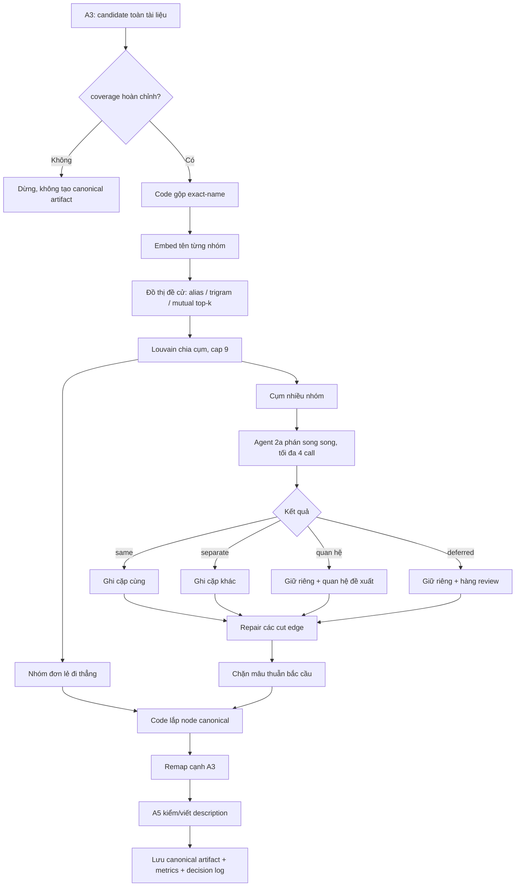

# Luồng chi tiết Agent 2a — A4 hợp nhất thực thể

Ngày đối chiếu: 2026-09-14 (quan hệ kiểu mở và luật nhất quán, ADR 0007)
Nguồn chuẩn: `doc/A4-A5-hop-nhat-thuc-the-spec.md` và mã hiện hành trong
`src/doc2roadmap/application/use_cases/canonicalize.py`,
`src/doc2roadmap/application/use_cases/canonical_reasoning.py`.

## 1. Kết luận ngắn

Agent 2a là **merge judge của A4**. Nó không đọc lần lượt 200 section và không tự xây toàn bộ lộ trình. A3 đã trích
ứng viên trước; code A4 gom các nhóm tên nghi trùng thành cụm nhỏ, rồi giao từng cụm cho agent 2a trả lời:

1. nhóm nào là cùng một thực thể (`same`);
2. nhóm nào phải giữ riêng (`separate`);
3. giữa hai node riêng có quan hệ gì, kiểu mở: cha–con là `subtype_of`, còn lại như `component_of`, `uses`… (ADR
   0007);
4. trường hợp nào chưa đủ bằng chứng (`deferred`).

Trong JSON thật, `same` và `separate` không phải hai trường riêng:

- hai `group_id` nằm trong cùng một phần tử `nodes` nghĩa là `same`;
- nằm trong hai phần tử `nodes` khác nhau nghĩa là `separate`;
- `relations` và `deferred` là hai trường tường minh.

Chỉ `same` làm các nhóm được gộp. Ba kết quả còn lại đều giữ node tách biệt. Agent chỉ đưa ra quyết định; code kiểm
định cấu trúc, lắp node canonical và lưu artifact.

## 2. Ranh giới trách nhiệm

| Thành phần | Được làm | Không được làm |
|---|---|---|
| A3 | Trích ứng viên, alias, kiểu, draft và bằng chứng | Không hợp nhất xuyên section |
| Code A4 | Gộp tên khít, dựng đồ thị, chia cụm, kiểm JSON, lắp node và remap cạnh | Không dùng cosine/ngram để tự gộp tên khác nhau |
| Agent 2a | Phân hoạch cụm theo danh tính; đề xuất quan hệ kiểu mở giữa các node đã tách; hoãn khi thiếu bằng chứng | Không chọn tên/kiểu/alias/description; không tạo `requires` |
| A5 | Kiểm hoặc viết mô tả có citation sau khi node đã chốt | Không đổi quyết định merge |
| Agent 2b | Xác minh và tạo cạnh tiên quyết ở đợt sau | Không tạo hoặc hợp nhất node |
| A13/người review | Xem log, conflict, deferred và có thể sửa quyết định | Không nằm trong runtime tự động của 2a |

`doc/spec-preview.md` còn mô tả khái quát rằng agent 2a chọn tên và description. Bản triển khai hiện hành đã tách hai
việc đó khỏi merge judge: code chọn tên/kiểu/alias, A5 viết description.

## 3. Sơ đồ toàn luồng



Các stage có hàng rào tuần tự: `merge → repair → lắp node → A5`. Chỉ các call độc lập **bên trong cùng stage** chạy
song song.

## 4. Đầu vào bắt buộc

Lệnh đầy đủ hiện tại:

```powershell
doc2roadmap a4 --doc-id <doc-id> --gold tests/fixtures/a4/gold-blind.json
```

Điều kiện trước khi chạy:

- có artifact A3 `candidates` mới nhất;
- A3 phải có `coverage_incomplete=false`, tức mọi section đã được xử lý kỹ thuật thành công và media bắt buộc có
  mô tả; cờ này không khẳng định recall khái niệm đạt 100%;
- có embedding tên;
- CLI hiện yêu cầu bộ vàng hoàn chỉnh và phải chứa tài liệu đang chạy; bộ vàng chỉ mở khóa/chấm, **không được đưa
  vào prompt phán**;
- có API key khi decision cache chưa chứa kết quả tương ứng.

Hai chế độ không gọi agent đầy đủ:

- `--names-only`: chỉ gộp tên khít bằng code;
- `--prepare`: gộp tên, embed, dựng cạnh và chia cụm nhưng chưa phán.

Media đi đường riêng: khử trùng theo `media_id`, không tham gia đồ thị tên, agent 2a hay A5.

## 5. Bước 1 — Gộp tên khít bằng code

A3 có thể tạo nhiều candidate cùng tên ở các section khác nhau. Code tạo `name_key` bằng cách:

- chuẩn hóa Unicode;
- casefold;
- gộp khoảng trắng;
- quy vị trí dấu thanh về một kiểu.

Các candidate cùng `name_key` trở thành một **exact-name group**. Đây là lần tự gộp duy nhất không cần LLM.

Ví dụ:

```text
“Hóa học” ở chương 1
“hoá học” ở chương 4
        ↓ cùng name_key
g_hoa_hoc gồm cả hai candidate
```

Alias, n-gram và embedding không có quyền tự gộp. Chúng chỉ đưa hai group vào vùng để agent xem xét.

## 6. Bước 2 — Vector đại diện cho nhóm tên

A4 embed **tên candidate**, không embed description để phán đồng nhất. Với group có nhiều candidate:

1. chuẩn hóa từng vector tên về vector đơn vị;
2. lấy trung bình theo từng chiều;
3. chuẩn hóa vector trung bình thêm một lần.

Description không được dùng làm kênh đề cử vì các khái niệm liên quan hoặc anh em thường có mô tả gần nhau nhưng
không phải cùng danh tính.

## 7. Bước 3 — Dựng đồ thị đề cử

Mỗi đỉnh là một exact-name group. Một cặp có cạnh nếu đạt ít nhất một trong ba kênh:

### 7.1 Alias

Tên/alias không phải ký hiệu ở group này khớp tên/alias group kia. Cạnh alias có trọng số `1.0`, nhưng vẫn chỉ là
đề cử vì alias do A3 sinh có thể sai.

### 7.2 Character trigram

Tên được bỏ dấu, chữ thường và chuẩn hóa dấu câu; sau đó cắt thành tập chuỗi ba ký tự liên tiếp, kể cả khoảng trắng.
Điểm là Jaccard:

```text
|trigram(A) ∩ trigram(B)| / |trigram(A) ∪ trigram(B)|
```

Với ngưỡng `0.5`:

```text
“Mạng nơ-ron”          → “mang no ron”
“Mạng nơ-ron nhân tạo” → “mang no ron nhan tao”

9 trigram chung / 18 trigram hợp = 0.5 → có cạnh đề cử
```

```text
“Học máy” → “hoc may”
“Máy học” → “may hoc”

2 / 8 = 0.25 → không có cạnh n-gram
```

### 7.3 Mutual top-k theo embedding tên

Với `k=3`, A phải nằm trong ba hàng xóm gần nhất của B và B cũng phải nằm trong ba hàng xóm gần nhất của A; cosine
phải dương.

```text
Top 3 của “Mạng nơ-ron”: Neural network, Mạng học sâu, Perceptron
Top 3 của “Neural network”: Artificial neural network, Mạng nơ-ron, Deep neural network
```

Hai phía cùng thấy nhau nên có cạnh `name`. Nếu A xếp B thứ 2 nhưng B xếp A thứ 4 thì không có cạnh từ kênh này.
Điều kiện hai chiều hạn chế các tên chung chung trở thành hub nối quá nhiều group.

Nếu một cặp đạt nhiều kênh, hệ thống chỉ tạo một cạnh, ghi đủ danh sách kênh và lấy trọng số lớn nhất.

## 8. Bước 4 — Chia cụm

Code dùng Louvain với:

```env
DOC2ROADMAP_MERGE_NEIGHBORS=3
DOC2ROADMAP_MERGE_NGRAM_THRESHOLD=0.5
DOC2ROADMAP_MERGE_RESOLUTION=2
DOC2ROADMAP_MERGE_SEED=42
DOC2ROADMAP_MERGE_CLUSTER_CAP=9
```

| Tham số | Vai trò |
|---|---|
| `neighbors=3` | Số hàng xóm dùng cho mutual top-k |
| `ngram_threshold=0.5` | Jaccard trigram tối thiểu để đề cử |
| `resolution=2` | Mức chia cộng đồng; thường càng cao thì cụm càng nhỏ |
| `seed=42` | Giữ kết quả Louvain tái lập |
| `cluster_cap=9` | Không gửi quá chín group trong một cụm |

Thành phần vượt cap được chạy Louvain lại với resolution tăng gấp đôi cho tới khi mọi cụm không vượt trần. Cạnh
nằm giữa hai cụm sau chia được ghi vào `cut_edges` để xử lý ở lượt repair.

Nhóm không có cạnh không tạo LLM call: nó được giữ nguyên làm node đơn.

## 9. Bước 5 — Chuẩn bị hồ sơ cho agent

Mỗi group trong cụm được chuyển thành hồ sơ:

```json
{
  "group_id": "node_...",
  "name": "Overfitting",
  "aliases": [],
  "symbols": [],
  "source_fingerprint": "...",
  "node_types": ["concept"],
  "section_paths": ["Chương 3 > Huấn luyện"],
  "evidence": [
    {"chunk_id": "c_0040", "quote": "Quá khớp xảy ra khi..."}
  ],
  "context": []
}
```

Quy tắc đóng gói:

- lấy tối đa ba evidence quote đầu tiên theo thứ tự tài liệu;
- nếu evidence của candidate không nhắc tên hoặc alias, gửi thêm toàn văn chunk nguồn trong `context`;
- có `source_fingerprint` để đầu vào thay đổi thì cache không dùng nhầm;
- không gửi bộ vàng.

## 10. Bước 6 — Agent 2a phán cụm

Prompt (v3) buộc agent chỉ dùng bằng chứng nguyên văn, không dùng kiến thức nền, và chỉ gọi nhóm bằng `group_id`.
Output schema:

```json
{
  "nodes": [
    {"groups": ["g1", "g2"], "reason": "..."},
    {"groups": ["g3"], "reason": "..."}
  ],
  "relations": [
    {
      "source": "g3",
      "target": "g1",
      "edge_type": "subtype_of",
      "chunk_ids": ["c_0042"],
      "reason": "..."
    }
  ],
  "deferred": [
    {"group_id": "g4", "reason": "..."}
  ]
}
```

### 10.1 `same`

Hai group nằm trong cùng `nodes[i].groups`. Code ghi mọi cặp giữa chúng vào tập `same` để hợp thành một component.

```text
Overfitting + Quá khớp → một node canonical
```

### 10.2 `separate`

Hai group nằm trong hai phần tử `nodes` khác nhau. Code ghi cặp đó vào tập `different`, ngăn gộp trực tiếp và dùng
làm hàng rào chống gộp bắc cầu mâu thuẫn.

```text
Overfitting | Underfitting → hai node, không có cạnh taxonomy
```

Các quan hệ ngang hàng, đối nghịch hoặc chỉ liên quan đều là `separate`.

### 10.3 Quan hệ kiểu mở

Hai group vẫn nằm ở hai node riêng, đồng thời agent đề xuất một quan hệ có chunk bằng chứng. `edge_type` đọc từ `source`
sang `target`; `subtype_of` là quan hệ loại–cha, các kiểu khác do agent đặt tên.

```text
L2 Regularization ──subtype_of──> Regularization
Kiểm định giả thiết thống kê ──tests──> Giả thiết thống kê
```

Cạnh có `proposal=true`, `confirmed=false`, và `origins` cho biết nguồn. Nó không phải cạnh tiên quyết `requires`.

### 10.4 `deferred`

Group không đủ bằng chứng được đưa vào `deferred` với lý do. Trong lượt merge chính, group này không được gộp với
bất kỳ group nào trong cụm và được giữ riêng để review.

## 11. Bước 7 — Validator và fail-safe

Code không tin JSON chỉ vì model trả đúng schema bề mặt.

### 11.1 Kiểm phân hoạch

Mỗi `group_id` đầu vào phải xuất hiện **đúng một lần** trong `nodes` hoặc `deferred`:

- thiếu group → từ chối;
- lặp group → từ chối;
- sinh ID lạ → từ chối;
- node rỗng hoặc thiếu lý do → từ chối;
- sinh `requires` hay trường ngoài schema → từ chối.

Output sai được gửi lại một lần kèm lỗi cụ thể. Nếu lần hai vẫn sai, toàn cụm trở thành `deferred` và không có merge.
Raw output bị từ chối được giữ trong `decision_log` để điều tra.

### 11.2 Kiểm nhất quán (R1, R2)

Đầu ra tự mâu thuẫn thì bị từ chối như lỗi phân hoạch: gửi lại một lần kèm lỗi, vẫn sai thì cả cụm `deferred`.
- **R1:** một quan hệ không đồng nhất nối hai group mà chính agent đặt chung node. Ví dụ agent gộp `Pessimistic
  Locking` với `Database Locking`, rồi lại ghi `subtype_of` giữa chúng.
- **R2:** một quan hệ đồng nhất (`same_as`, `equivalent_to`, `identical_to`, `synonym_of`, `alias_of`) nối hai node
  tách riêng.

Luật này không cần nhãn, vì nó chỉ dựa vào chính câu trả lời của agent. Ở lần chạy thật, 8 lượt thử bị bắt và cả 8 sửa
được ở lần thử lại. Một cái giá đã biết: khi được báo "tách hai nhóm", agent hay tách luôn cả node (F83).

### 11.3 Kiểm từng quan hệ

Quan hệ chỉ hợp lệ khi:

- source và target đều thuộc cụm, không `deferred`, và nằm ở hai node khác nhau;
- có reason;
- có ít nhất một `chunk_id` và mọi ID thuộc nguồn của source hoặc target;
- kiểu không rỗng, không phải `requires` hay đồng nghĩa, không phải kiểu dành cho media.

Quan hệ sai bị ghi `relation_rejected` và bỏ riêng; phân hoạch đúng vẫn được giữ.

### 11.4 Cache không còn hợp lệ

Quyết định cũ trong cache mà không qua được luật kiểm hiện hành thì bị gọi lại mô hình (`<stage>_cache_invalid`), thay
vì làm dừng cả lượt chạy.

### 11.5 Lỗi vận chuyển

HTTP, timeout hoặc lỗi mạng là `ModelTransportError`. Lỗi này dừng lượt A4 trước khi ghi artifact hoàn chỉnh, thay vì
đóng băng một kết quả fallback vào cache.

## 12. Bước 8 — Repair cạnh bị cắt

Louvain và cap có thể đặt hai group nghi trùng vào hai cụm khác nhau. Với mỗi cut edge chưa được giải quyết:

1. tìm component đã được merge ở hai đầu cạnh;
2. lấy **toàn bộ exact-name group** của cả hai component;
3. hợp thành một cụm repair nhỏ;
4. gọi lại đúng model, prompt và `PARTITION_SCHEMA` của lượt merge;
5. chỉ nối hai component nếu toàn bộ cụm repair được agent trả thành **một node duy nhất**.

Nếu agent tách cụm, trả `deferred` hoặc JSON sai, hai đầu vẫn giữ riêng. `deferred` ở repair là `deferred_pairs`, chỉ
hoãn cặp đang xét và không tháo những merge đúng đã có trong từng component.

Các repair có cùng tập group được khử trùng để không gọi LLM lặp lại.

## 13. Bước 9 — Chặn mâu thuẫn bắc cầu

Quan hệ `same` có tính bắc cầu:

```text
A same B
B same C
→ A, B, C có xu hướng thành một component
```

Nếu agent đồng thời đã phán `A separate C`, code không cho quyết định `same` âm thầm đè `separate`. Component mâu
thuẫn bị tách lại thành các node riêng, ghi `transitive_conflict` và đưa group vào review/deferred.

## 14. Bước 10 — Code lắp node canonical

Sau khi chốt component, code thực hiện phần agent 2a không được làm:

- **ID:** neo vào candidate sớm nhất và băm cùng `doc_id`;
- **tên:** chỉ bậc cao nhất được tranh: tên thuần chữ › tên có token ký hiệu › viết tắt; ký hiệu bị loại. Đếm tên
  dài và che trước để tên ngắn không ăn lại lần xuất hiện lồng bên trong; nếu hòa giữa tên lồng nhau thì chọn tên
  chứa tên kia, còn hòa thường theo vị trí rồi ID;
- **kiểu:** chuẩn hóa qua type registry rồi lấy đa số; hòa thì ưu tiên kiểu cụ thể hơn `concept`, sau đó tần suất toàn
  tài liệu và thứ tự chữ cái;
- **learnable:** bỏ phiếu trong các candidate có kiểu đã chọn;
- **alias/ký hiệu:** hợp từ các tên không được chọn và alias có evidence;
- **provenance:** hợp member IDs, chunk IDs, evidence và source refs;
- **thứ tự:** ban đầu lấy vị trí sớm nhất; A5 có thể dời `first_order_index` về chunk định nghĩa;
- **redirect:** nếu ID cũ biến mất sau thay đổi merge, lưu ánh xạ sang node mới khi tìm được thành viên chung.

Code sau đó ánh xạ cạnh A3 từ candidate ID sang canonical node ID, bỏ self-edge phát sinh do merge và khử cạnh trùng.

Quan hệ của agent được map về node sau khi đã chốt node. Hai đầu rơi vào cùng node thì quan hệ bị bỏ
(`relation_self_removed`). Quan hệ trùng bộ ba (nguồn, đích, kiểu) với cạnh A3 thành một cạnh, `origins: ["2a",
"a3"]`: giữ các trường của A3, hợp `chunk_ids`, thêm `reason` của agent. Mọi cạnh còn lại mang `origins` của nguồn
duy nhất của nó.

Tiếp theo code so từng `subtype_of` của agent với cạnh A3 trên cùng cặp node, bất kể chiều. Các kiểu A3 được so:
`component_of`, `uses`, `solves`, `prevents`, `causes`, `computed_by`, `contrasts_with`. Gặp trùng thì **giữ cả hai
cạnh** và ghi dòng `subtype_conflicts_a3` (kèm kiểu cạnh A3) vào nhật ký (F75).

Luật này không xoá cạnh, vì trên bộ vàng agent thường đúng hơn A3 ở các cặp này. Ví dụ: A3 gắn
`Gaussian Naive Bayes` là `component_of` `Naïve Bayes`, trong khi đó là một loại con.

## 15. Bước 11 — A5 sau Agent 2a

A5 dùng model cấu hình riêng và không thay đổi phân hoạch:

- node có nhiều candidate: luôn tổng hợp description mới;
- node đơn: kiểm theo lô tối đa 10 node; giữ draft nếu có bằng chứng, đúng ngôn ngữ và hợp lệ, nếu không thì viết lại;
- description có 1–4 câu, mỗi câu phải trích ít nhất một chunk thuộc node;
- `defining_chunk_ids` phải nằm trong các citation đã dùng;
- ngôn ngữ theo majority token của phần văn xuôi, bỏ chunk thuần bảng/code/công thức/hình;
- nguồn mâu thuẫn được gắn `nghi_gop_nham`, không tự hòa giải bằng kiến thức nền;
- output sai hai lần thì giữ draft với `description_status=draft_fallback_invalid`.

Do đó “A4/2a merge” và “A5 description” cùng nằm trong artifact `canonical` nhưng là hai trách nhiệm và hai nhóm
LLM call khác nhau.

## 16. Concurrency và số LLM call

Cấu hình hiện tại:

```env
DOC2ROADMAP_MERGE_MODEL_ID=gemini-3.1-flash-lite
DOC2ROADMAP_DESCRIPTION_MODEL_ID=gemini-3.1-flash-lite
DOC2ROADMAP_CANONICAL_BATCH_SIZE=10
DOC2ROADMAP_CANONICAL_CONCURRENCY=4
```

`CANONICAL_CONCURRENCY=4` nghĩa là tối đa bốn call chạy đồng thời trong từng stage của một tài liệu. Nó không có
nghĩa 200 section sẽ tạo ngay 200 call:

- A3 mới là bước xử lý section;
- Agent 2a gọi theo **cụm nhiều group**, singleton không gọi;
- repair gọi theo tập component duy nhất ở hai đầu cut edge;
- A5 kiểm singleton theo lô 10, còn synthesis/rewrite gọi theo node cần viết;
- stage sau chỉ bắt đầu khi stage trước hoàn thành.

Có thể ước lượng:

```text
merge jobs  = số cụm nhiều group chưa có cache
repair jobs = số tập component duy nhất cần xét lại
A5 check    = ceil(số singleton / 10)
A5 describe = số node nhiều member + số singleton cần rewrite
```

Một job JSON sai có thể tốn thêm một call retry. Cache làm số call thật thấp hơn công thức khi input, model, prompt
và schema không đổi.

## 17. Cache, version và artifact đầu ra

### 17.1 Cache toàn artifact

Nếu `source_hash` và `config_hash` khớp artifact đã có, A4 trả `reused=true` và không chạy lại các stage.
`config_hash` bao gồm candidate version/hash, type registry, embedding model/công thức, cấu hình đồ thị và cấu hình
reasoning.

### 17.2 Cache từng quyết định

Mỗi call merge/repair/A5 có khóa băm từ:

```text
model ID + prompt hash + schema + generation config + input data
```

Chỉ log `valid=true` mới được tái sử dụng. Vì vậy sửa một section chỉ buộc gọi lại cụm/node có hồ sơ thay đổi.

### 17.3 Artifact `canonical`

Artifact hoàn chỉnh chứa:

- `nodes`, `members`, `edges`;
- `decision_log` gồm input/output, model, prompt hash, retry và raw output hỏng;
- `deferred`, `deferred_pairs`, `review`, `redirects`;
- toàn bộ `nominations`: edges, clusters và cut edges;
- `stats` và `jaccard_previous`;
- snapshot `source_candidates` để có thể review/tách lại mà không trích A3 lần nữa.

## 18. Ví dụ xuyên suốt

Giả sử A3 tạo bốn exact-name group:

```text
g1: Overfitting
g2: Quá khớp
g3: Regularization
g4: L2 Regularization
```

Đồ thị đề cử nối `g1–g2` qua alias/embedding và `g3–g4` qua n-gram/embedding. Agent nhận một hoặc hai cụm tùy
Louvain và trả:

```json
{
  "nodes": [
    {"groups": ["g1", "g2"], "reason": "Hai tên cùng chỉ hiện tượng quá khớp."},
    {"groups": ["g3"], "reason": "Khái niệm regularization tổng quát."},
    {"groups": ["g4"], "reason": "Một kỹ thuật regularization cụ thể."}
  ],
  "relations": [
    {
      "source": "g4",
      "target": "g3",
      "edge_type": "subtype_of",
      "chunk_ids": ["c_0043"],
      "reason": "Tài liệu nói L2 là một kỹ thuật regularization."
    },
    {
      "source": "g3",
      "target": "g1",
      "edge_type": "prevents",
      "chunk_ids": ["c_0044"],
      "reason": "Tài liệu nói regularization được dùng để tránh quá khớp."
    }
  ],
  "deferred": []
}
```

Kết quả sau code và A5:

```text
Node A: Overfitting
  aliases: Quá khớp
  members: candidate của g1 + g2
  description: câu có citation từ cả hai nguồn

Node B: Regularization
Node C: L2 Regularization
Node C ──subtype_of (proposal, origins=[2a])──> Node B
Node B ──prevents (proposal, origins=[2a])──> Node A
```

Nếu agent gộp `g3` với `g4` rồi lại ghi `g4 subtype_of g3`, luật R1 bắt mâu thuẫn và agent phải phán lại cụm.

Nếu evidence không chứng minh `g1 ≡ g2`, agent phải tách hoặc deferred; nó không được dựa vào kiến thức nền để gộp.

## 19. Chỉ số cần theo dõi

| Metric | Ý nghĩa |
|---|---|
| `nomination_edges` | Tổng cạnh đề cử |
| `nomination_channels` | Số cạnh theo alias/ngram/name |
| `cluster_count`, `largest_cluster` | Số cụm và cụm lớn nhất |
| `cut_edge_count` | Cạnh bị cắt cần xem xét repair |
| `merge_calls`, `merge_reused`, `merge_invalid` | Chi phí/cache/lỗi lượt chính |
| `repair_calls`, `repair_merged_pairs` | Chi phí và số repair thực sự gộp |
| `relation_rejected` | Quan hệ agent đề xuất nhưng lớp kiểm từng quan hệ loại |
| `relation_edges`, `relation_types` | Số cạnh quan hệ 2a sau khi gộp trùng, và đếm theo kiểu |
| `relation_same_as_a3`, `relation_same_type_reversed_a3`, `relation_other_type_than_a3`, `relation_new_pair` | Quan hệ 2a so với cạnh A3 trên cùng cặp: trùng hệt, cùng kiểu ngược chiều, khác kiểu, cặp A3 chưa nối |
| `relation_self_removed` | Quan hệ bị bỏ vì hai đầu thành một node sau lượt vá |
| `partition_contradictions`, `contradiction_retried_calls`, `contradiction_deferred_calls` | Lượt thử bị R1/R2 bắt, số lượt phán phải thử lại, số lượt phán bị hoãn vì vẫn mâu thuẫn. Đếm từ nhật ký, kể cả quyết định dùng lại |
| `merge_cache_invalid`, `repair_cache_invalid` | Quyết định trong cache không qua luật kiểm hiện hành nên phải gọi lại |
| `subtype_conflicts_a3` | Cạnh subtype trùng cặp với cạnh A3 khác nghĩa "là một loại" — giữ, chỉ ghi |
| `deferred_groups`, `deferred_pairs` | Việc chưa đủ bằng chứng |
| `transitive_conflicts` | Mâu thuẫn same/different bắc cầu |
| `merged_group_count`, `merge_ratio` | Mức độ hợp nhất |
| `a5_kept`, `a5_synthesized`, `a5_rewritten_*` | Hành vi description |
| `nghi_gop_nham` | Node có nguồn mô tả mâu thuẫn |

Trên bốn tài liệu đã chốt, cấu hình hiện tại đạt 31 TP, 0 FP, 16 FN trên 47 cặp cùng: precision 1,000, recall
0,660, F1 0,795. Đồ thị đề cử bắt 47/47 cặp cùng trong bộ vàng; phần còn bỏ sót nằm ở phán quyết merge, không ở
candidate recall của corpus đo hiện tại.

Về `subtype_of`: có 61 cạnh; trên cặp có nhãn, 33 cạnh đúng và 19 cạnh sai, tức precision 0,635. Vì vậy 2b chỉ dùng
`subtype_of` như đề xuất.

A/B F72 thử thêm prompt biến thể và model Pro, nhưng không nhánh nào thắng cấu hình này theo luật chọn viết trước khi
chạy. Xem báo cáo chạy thật, mục A/B.

## 20. Các bất biến an toàn

1. Chỉ exact-name được code tự gộp; mọi tên khác phải qua agent.
2. Mỗi group xuất hiện đúng một lần trong `nodes` hoặc `deferred`.
3. `same` là kết quả duy nhất cho phép hợp nhất.
4. `separate`, quan hệ và `deferred` đều giữ node riêng.
5. Mọi quan hệ phải có evidence thuộc nguồn hai đầu, và không bao giờ là `requires`.
6. Một quan hệ sai không được làm mất phân hoạch đúng. Nhưng một câu trả lời tự mâu thuẫn (R1, R2) thì bị phán lại cả
   cụm.
7. Repair không được tháo merge đúng đã có chỉ vì cặp repair bị deferred.
8. Mâu thuẫn bắc cầu không được âm thầm hợp nhất.
9. Lỗi mạng không tạo artifact fallback/cache giả.
10. Bộ vàng không xuất hiện trong prompt phán.
