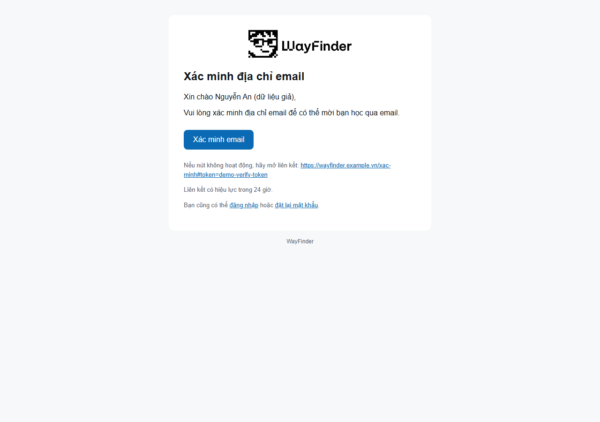
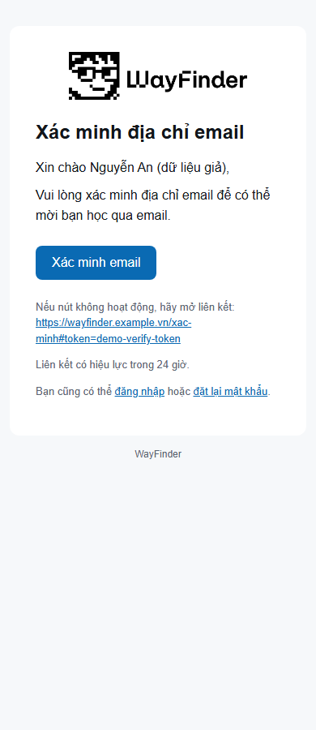
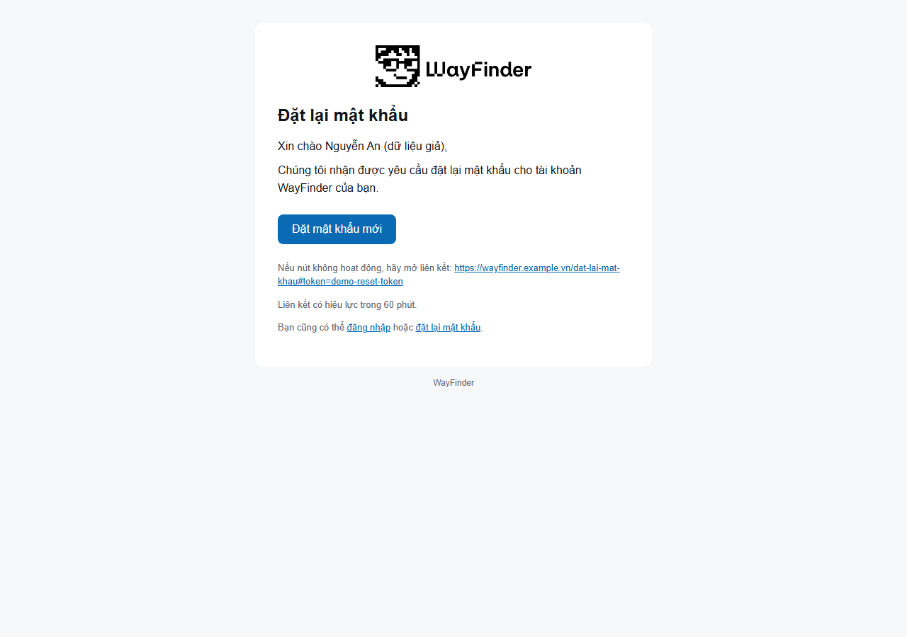
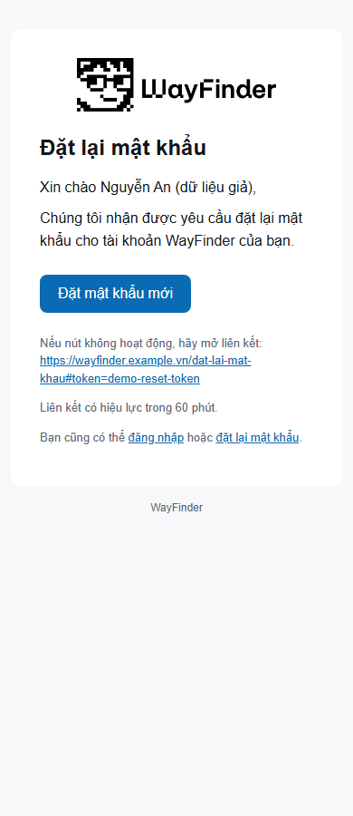
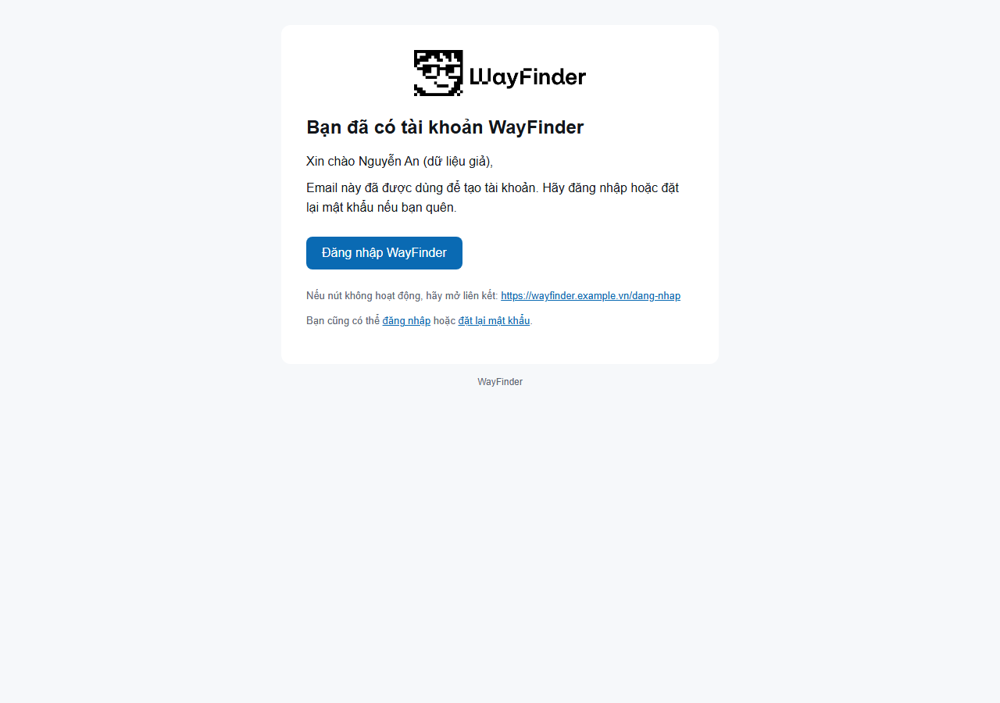
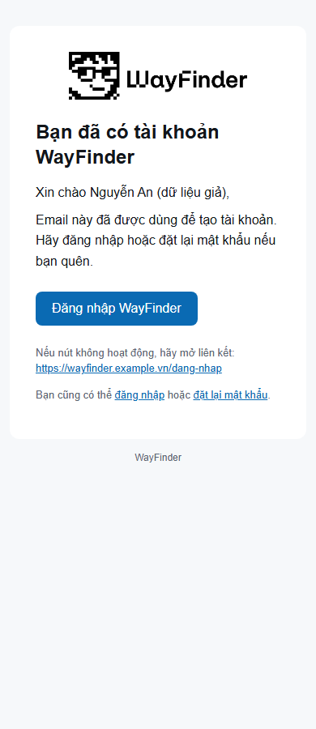

# Email template visual review

Regenerated all three HTML samples through `render_account_email()` and rendered them at 1280px desktop and 390px mobile in cached local Chromium. Playwright fulfilled only `https://wayfinder.example.vn/assets/Artboard%2024.png` from the worktree's `src/web/frontend/public/assets/Artboard 24.png`; all other network requests were blocked.

- All six renders show the expected WayFinder logo, heading, body copy, expiry where applicable, and primary action.
- No horizontal overflow at either viewport width; document body width matches the viewport.
- No page errors; the logo loaded from the local asset in each render.
- The verification copy now describes confirming email to invite classmates by email.
- Parsed and asserted the primary action links at both widths, including an empty query string:
  - Verify: path `/xac-minh`, hash `#token=demo-verify-token`.
  - Reset: path `/dat-lai-mat-khau`, hash `#token=demo-reset-token`.
  - Existing account: path `/dang-nhap`, no hash.

| Sample | Desktop (1280px) | Mobile (390px) |
|---|---|---|
| Verify |  |  |
| Reset |  |  |
| Existing account |  |  |

Rerun with [render_samples.py](render_samples.py), then [email_visual_check.cjs](email_visual_check.cjs). Machine-readable viewport, logo-load, and parsed-link results: [visual-metadata.json](visual-metadata.json).
